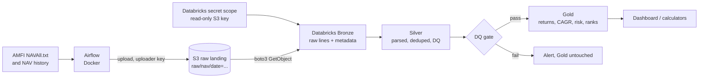

# Mutual Fund NAV Lakehouse

[](https://github.com/twarangupta/mf-nav-lakehouse/actions/workflows/ci.yml)

A daily batch pipeline that collects Net Asset Value (NAV) data for every Indian mutual fund scheme from AMFI, stores it in a Delta Lake lakehouse on Databricks using the Medallion architecture (Bronze, Silver, Gold), computes fund analytics (rolling returns, CAGR, volatility, drawdown) and is orchestrated end to end by Apache Airflow.

**Status:** Phases 1 to 4 complete: daily NAV files and almost 6 years of history land in S3, flow through Bronze and a quality-gated Silver table, and Gold computes returns, CAGR, volatility, drawdown and category ranks for every active Growth scheme. Dashboards, performance and orchestration come next. Real numbers are added below as they are measured.

## Architecture



Planned daily DAG: `check_source >> download_nav >> upload_raw >> trigger_databricks_bronze >> silver >> data_quality_gate >> gold >> notify`. The quality gate runs before Gold, so data that fails it never reaches Gold.

## Key design choices

- **Airflow downloads, Databricks processes.** Databricks Free Edition serverless restricts outbound internet, so the orchestrator lands each raw file and Spark only reads landed files. A raw copy is kept for replays.
- **S3 is the single raw landing zone.** Each daily file is saved byte for byte to `s3://<bucket>/raw/nav/date=YYYY-MM-DD/NAVAll.txt`. The Bronze job reads it with boto3 using a read-only IAM user key kept in a Databricks secret scope (never in code). The recommended Unity Catalog route (storage credential + IAM role with an external ID) was built but is refused on this setup: the Free Edition workspace runs in us-east-2, the AWS free-plan account is locked to ap-southeast-2, and the AWS free plan does not support cross-region features. Details: [infra/aws/README.md](infra/aws/README.md).
- **Backfill in polite, restartable chunks.** History is fetched one 7-day range at a time, sequentially, with a pause and retries after 5, 15 and 45 s. A chunk already in S3 is skipped, and Bronze skips files whose hash it already has, so either step can be stopped and rerun safely.
- **Bronze keeps every raw line, in order.** One row per line (data rows, category and fund house headers, blank lines) with its line number, because an AMFI header line applies to the rows below it. Reruns add nothing: a file already loaded for the same date with the same SHA-256 is skipped.
- **Least privilege, two separate keys.** The uploader ([policy](infra/aws/iam_policy_airflow_uploader.json)) can list, read and write under `raw/` but cannot delete. The Databricks reader ([policy](infra/aws/iam_policy_databricks_read.json)) can only list and read. If either key leaks, only that one is revoked.
- **Silver: parse, check, gate, MERGE.** Each data line inherits the category and fund house from the AMFI header lines above it (a window ordered by line number), is parsed by its file's own column layout (the daily file and the history report differ), and gets plan (Direct/Regular) and option (Growth/IDCW/Bonus) from simple, tested rules. Rows that break a hard rule go to `silver.nav_quarantine` with a reason; a file with more than 1% bad rows, or an unknown header, is rejected as a whole and the job fails, so Gold never sees it. Good rows are MERGEd on (scheme_code, nav_date), so reruns never double count. Big day-over-day moves on Growth plans are flagged in `silver.dq_warnings`, not removed.
- **Gold: honest fund analytics.** "NAV n years ago" is an as-of lookup (last NAV on or before the date, ignored if more than 7 days stale), so holidays are handled and young funds get no partial numbers. Daily returns are measured only between real NAV dates (no forward filling), and volatility is annualised with each fund's real number of NAVs per year (median 247; 365 for liquid funds). Metrics are left empty when the window contains a unit reset flagged in Silver (47 schemes) or the NAV is flat (6 daily-dividend style plans), rather than showing a wrong number. Funds are ranked within a standardised category group and plan, because AMFI writes some categories two ways.
- **Returns use Growth plans only.** IDCW (dividend) NAVs drop on every payout, so they are not total-return series. CAGR, rolling returns and volatility use Growth option plans only. IDCW rows stay in Silver because their latest NAV is still valid.
- **Category comes from AMFI.** Category and fund house are taken from the header lines of the latest daily NAVAll.txt; history is used for NAV values only.
- **Why Spark at this size.** About 14M rows and 2 GB of raw text would fit on one machine (DuckDB or Polars would handle it). Spark is used because Databricks and Delta Lake are Spark-native and the same code runs unchanged at 100x the volume.

## Source data (measured 2026-11-11)

| Measure | Value |
|---|---|
| NAVAll.txt | 1.53 MB, 18,246 lines, 14,445 scheme rows, 104 category header lines |
| Rows on the latest two NAV dates | 8,779 (the rest are closed or matured schemes) |
| Rows with NAV 0.0000 | 241 (segregated portfolios) |
| AMFI history sample (5 days, Jan 2021) | 29,383 rows, about 9,200 per business day |
| Estimated 5-year history | about 14M rows |

## Results so far

| Measure | Value |
|---|---|
| Bronze table | `mf_nav.bronze.nav_raw_lines` |
| Daily file loaded (2026-11-12, read from S3) | 18,251 rows in a 26 s serverless run |
| Rerun of the same file | 0 rows added (idempotent) |
| History backfill to S3 (2021-01-01 to 2026-11-15) | 307 weekly files, 1.58 GB, 11,816,895 price rows, 73.4 min, 0 failures |
| History load into Bronze | 12,443,113 lines from 306 files in 658 s (39 batches); rerun adds 0 rows |
| Bronze total | 12,529,520 lines from 309 files; no missing or duplicate line numbers |
| Silver `mf_nav.silver.nav` | 11,653,085 NAV records, one per scheme per day (17,261 schemes), every row with an AMFI category and fund house |
| Rows quarantined with a reason | 167,407 (159,416 expected zero NAVs of segregated portfolios, 7,978 other non-positive NAVs, 13 "N.A.") |
| Quality gate | 309 files checked, 0 rejected; worst file 0.26% bad (threshold 1%) |
| Silver full rebuild from Bronze | 120 s on serverless; rerun with no new files 17 s |
| Recovery drill | a deliberately corrupted day (8,716 rows) found with Delta time travel and restored with `RESTORE TABLE` |
| Gold `mf_nav.gold.fund_metrics` (as of 2026-11-15) | 3,716 active Growth schemes; 2,489 with a 3Y CAGR, 1,805 with 5Y; medians: 1Y return 4.24%, 3Y CAGR 9.64%, volatility 13.72%, max drawdown -14.82% |
| Gold build | 6 tables in 45 s on serverless; dashboard tables under 2 MB |
| Spot-check | 1Y, 3Y, 5Y returns of 4 well-known funds recomputed independently in plain Python from mfapi.in: 0.00 basis points difference |
| Unit tests | 78, on a local SparkSession (Java 17) |

## Roadmap

1. Dashboards: a Databricks SQL dashboard on Gold (screenshots in this README), and small Gold summary exports in `exports/gold/` (Parquet plus a manifest of row counts and export time) that feed a permanent public Streamlit dashboard in a separate repo. No credentials in the public app. Data: AMFI.
2. Performance benchmarks, Airflow orchestration, interview pack.

## Tech stack

PySpark, Databricks (Free Edition, serverless), Delta Lake, Apache Airflow 3.x in Docker (LocalExecutor + Postgres), AWS S3 and IAM, Python 3.11, pytest, ruff, GitHub Actions.

## Repo layout

```
dags/          Airflow DAGs
src/ingest/    downloaders: daily NAVAll.txt and the history backfill, to S3 byte for byte
src/jobs/      PySpark jobs run on Databricks: bronze_nav.py, silver_nav.py, gold_nav.py
scripts/       run a job on Databricks serverless; load the S3 reader key into Databricks secrets
tests/         pytest unit tests (DAG integrity and PySpark tests added as code lands)
.github/       CI workflow (ruff + pytest on every push and pull request)
infra/aws/     least-privilege IAM policies (uploader, Databricks reader) and role templates
infra/airflow/ local Airflow in Docker
```

## Run the checks locally

```bash
uv venv --python 3.11 .venv
uv pip install --python .venv/Scripts/python.exe -e ".[dev]"   # .venv/bin/python on Mac or Linux
.venv/Scripts/ruff.exe check .
.venv/Scripts/ruff.exe format --check .
.venv/Scripts/python.exe -m pytest -v
```

The Spark tests need Java 17 (`JAVA_HOME`); without it they are skipped locally. CI installs Java and never skips them.

## Run it by hand (before Airflow)

```bash
python -m src.ingest.nav_download                     # land today's file in S3
python -m src.ingest.nav_history --start 2021-01-01 --end 2026-11-15   # one-off history backfill
python scripts/run_on_databricks.py src/jobs/silver_nav.py --run-id manual-1  # add --full-refresh to rebuild
python scripts/run_on_databricks.py src/jobs/gold_nav.py --run-id manual-1
python scripts/run_on_databricks.py src/jobs/bronze_nav.py     --source-path s3://<bucket>/raw/nav/date=YYYY-MM-DD/ --run-id manual-1
```

Both read settings from `.env`. On Git Bash for Windows, prefix commands that pass `/Volumes/...` paths with `MSYS_NO_PATHCONV=1`.

CI runs the same checks on every push and pull request to `main`. It uses no secrets and makes no calls to Databricks, AWS or AMFI.

## Configuration and secrets

No secrets live in this repo. Copy `.env.example` to `.env` (git-ignored) and fill it in locally; Airflow reads credentials from its Connections and Variables. A test checks that every environment variable the code reads is listed in `.env.example` and that the example file contains no real secret values.
