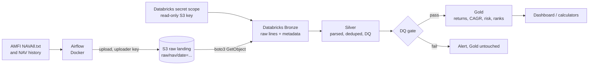

# Mutual Fund NAV Lakehouse

[](https://github.com/twarangupta/mf-nav-lakehouse/actions/workflows/ci.yml)

A daily batch pipeline that collects Net Asset Value (NAV) data for every Indian mutual fund scheme from AMFI, stores it in a Delta Lake lakehouse on Databricks using the Medallion architecture (Bronze, Silver, Gold), computes fund analytics (rolling returns, CAGR, volatility, drawdown) and is orchestrated end to end by Apache Airflow.

**Status:** Phase 1 (ingest to Bronze) complete: daily NAV files land in S3 and load into a Bronze Delta table on Databricks. Backfill, Silver, Gold, the dashboard, performance and orchestration come next. Real numbers are added below as they are measured.

## Architecture



Planned daily DAG: `check_source >> download_nav >> upload_raw >> trigger_databricks_bronze >> silver >> data_quality_gate >> gold >> notify`. The quality gate runs before Gold, so data that fails it never reaches Gold.

## Key design choices

- **Airflow downloads, Databricks processes.** Databricks Free Edition serverless restricts outbound internet, so the orchestrator lands each raw file and Spark only reads landed files. A raw copy is kept for replays.
- **S3 is the single raw landing zone.** Each daily file is saved byte for byte to `s3://<bucket>/raw/nav/date=YYYY-MM-DD/NAVAll.txt`. The Bronze job reads it with boto3 using a read-only IAM user key kept in a Databricks secret scope (never in code). The recommended Unity Catalog route (storage credential + IAM role with an external ID) was built but is refused on this setup: the Free Edition workspace runs in us-east-2, the AWS free-plan account is locked to ap-southeast-2, and the AWS free plan does not support cross-region features. Details: [infra/aws/README.md](infra/aws/README.md).
- **Bronze keeps every raw line, in order.** One row per line (data rows, category and fund house headers, blank lines) with its line number, because an AMFI header line applies to the rows below it. Reruns add nothing: a file already loaded for the same date with the same SHA-256 is skipped.
- **Least privilege, two separate keys.** The uploader ([policy](infra/aws/iam_policy_airflow_uploader.json)) can list, read and write under `raw/` but cannot delete. The Databricks reader ([policy](infra/aws/iam_policy_databricks_read.json)) can only list and read. If either key leaks, only that one is revoked.
- **Returns use Growth plans only.** IDCW (dividend) NAVs drop on every payout, so they are not total-return series. CAGR, rolling returns and volatility use Growth option plans only. IDCW rows stay in Silver because their latest NAV is still valid.
- **Category comes from AMFI.** Category and fund house are taken from the header lines of the latest daily NAVAll.txt; history is used for NAV values only.
- **Why Spark at this size.** About 14M rows and 2 GB of raw text would fit on one machine (DuckDB or Polars would handle it). Spark is used because Databricks and Delta Lake are Spark-native and the same code runs unchanged at 100x the volume.

## Source data (measured 2026-11-11)

| Measure | Value |
|---|---|
| NAVAll.txt | 1.53 MB, 18,246 lines, 14,445 scheme rows, 104 category header lines |
| Rows on the latest two NAV dates | 8,779 (the rest are closed or matured schemes) |
| Rows with NAV 0.0000 | 241 (segregated portfolios) |
| AMFI history sample (5 days, Jan 2021) | 29,383 rows, about 9,200 per business day |
| Estimated 5-year history | about 14M rows |

## Results so far

| Measure | Value |
|---|---|
| Bronze table | `mf_nav.bronze.nav_raw_lines` |
| Daily file loaded (2026-11-12, read from S3) | 18,251 rows in a 26 s serverless run |
| Rerun of the same file | 0 rows added (idempotent) |
| Unit tests | 27, on a local SparkSession (Java 17) |

## Tech stack

PySpark, Databricks (Free Edition, serverless), Delta Lake, Apache Airflow 3.x in Docker (LocalExecutor + Postgres), AWS S3 and IAM, Python 3.11, pytest, ruff, GitHub Actions.

## Repo layout

```
dags/          Airflow DAGs
src/ingest/    downloader: AMFI NAVAll.txt to S3, byte for byte
src/jobs/      PySpark jobs run on Databricks (bronze, silver, gold)
scripts/       run a job on Databricks serverless; load the S3 reader key into Databricks secrets
tests/         pytest unit tests (DAG integrity and PySpark tests added as code lands)
.github/       CI workflow (ruff + pytest on every push and pull request)
infra/aws/     least-privilege IAM policies (uploader, Databricks reader) and role templates
infra/airflow/ local Airflow in Docker
```

## Run the checks locally

```bash
uv venv --python 3.11 .venv
uv pip install --python .venv/Scripts/python.exe -e ".[dev]"   # .venv/bin/python on Mac or Linux
.venv/Scripts/ruff.exe check .
.venv/Scripts/ruff.exe format --check .
.venv/Scripts/python.exe -m pytest -v
```

The Spark tests need Java 17 (`JAVA_HOME`); without it they are skipped locally. CI installs Java and never skips them.

## Run it by hand (before Airflow)

```bash
python -m src.ingest.nav_download                     # land today's file in S3
python scripts/run_on_databricks.py src/jobs/bronze_nav.py     --source-path s3://<bucket>/raw/nav/date=YYYY-MM-DD/ --run-id manual-1
```

Both read settings from `.env`. On Git Bash for Windows, prefix commands that pass `/Volumes/...` paths with `MSYS_NO_PATHCONV=1`.

CI runs the same checks on every push and pull request to `main`. It uses no secrets and makes no calls to Databricks, AWS or AMFI.

## Configuration and secrets

No secrets live in this repo. Copy `.env.example` to `.env` (git-ignored) and fill it in locally; Airflow reads credentials from its Connections and Variables. A test checks that every environment variable the code reads is listed in `.env.example` and that the example file contains no real secret values.
