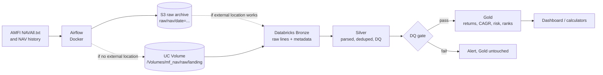

# Mutual Fund NAV Lakehouse

[](https://github.com/twarangupta/mf-nav-lakehouse/actions/workflows/ci.yml)

A daily batch pipeline that collects Net Asset Value (NAV) data for every Indian mutual fund scheme from AMFI, stores it in a Delta Lake lakehouse on Databricks using the Medallion architecture (Bronze, Silver, Gold), computes fund analytics (rolling returns, CAGR, volatility, drawdown) and is orchestrated end to end by Apache Airflow.

**Status:** Phase 0 (setup) complete. Ingestion, backfill, Silver, Gold, performance and orchestration are built next, phase by phase. Real row counts, run times and benchmark results will be added here as they are measured.

## Architecture



Planned daily DAG: `check_source >> download_nav >> upload_raw >> trigger_databricks_bronze >> silver >> data_quality_gate >> gold >> notify`. The quality gate runs before Gold, so data that fails it never reaches Gold.

## Key design choices

- **Airflow downloads, Databricks processes.** Databricks Free Edition serverless restricts outbound internet, so the orchestrator lands each raw file and Spark only reads landed files. A raw copy is kept for replays.
- **Raw landing zone (S3).** If the workspace can read the S3 bucket through a Unity Catalog external location, S3 is the landing zone. If not, Airflow writes each file to both S3 (a durable raw archive outside the workspace) and a Unity Catalog Volume (what Databricks reads). This README will state which one is in use once it is tested.
- **Least privilege.** The uploader's IAM policy ([infra/aws/iam_policy_airflow_uploader.json](infra/aws/iam_policy_airflow_uploader.json)) can list, read and write objects under `raw/` in one bucket. It cannot delete anything or touch other buckets.
- **Returns use Growth plans only.** IDCW (dividend) NAVs drop on every payout, so they are not total-return series. CAGR, rolling returns and volatility use Growth option plans only. IDCW rows stay in Silver because their latest NAV is still valid.
- **Category comes from AMFI.** Category and fund house are taken from the header lines of the latest daily NAVAll.txt; history is used for NAV values only.
- **Why Spark at this size.** About 14M rows and 2 GB of raw text would fit on one machine (DuckDB or Polars would handle it). Spark is used because Databricks and Delta Lake are Spark-native and the same code runs unchanged at 100x the volume.

## Source data (measured 2026-11-11)

| Measure | Value |
|---|---|
| NAVAll.txt | 1.53 MB, 18,246 lines, 14,445 scheme rows, 104 category header lines |
| Rows on the latest two NAV dates | 8,779 (the rest are closed or matured schemes) |
| Rows with NAV 0.0000 | 241 (segregated portfolios) |
| AMFI history sample (5 days, Jan 2021) | 29,383 rows, about 9,200 per business day |
| Estimated 5-year history | about 14M rows |

## Tech stack

PySpark, Databricks (Free Edition, serverless), Delta Lake, Apache Airflow 3.x in Docker (LocalExecutor + Postgres), AWS S3 and IAM, Python 3.11, pytest, ruff, GitHub Actions.

## Repo layout

```
dags/          Airflow DAGs
src/jobs/      PySpark jobs run on Databricks (bronze, silver, gold)
tests/         pytest unit tests (DAG integrity and PySpark tests added as code lands)
.github/       CI workflow (ruff + pytest on every push and pull request)
infra/aws/     least-privilege IAM policy for the S3 uploader
infra/airflow/ local Airflow in Docker
```

## Run the checks locally

```bash
uv venv --python 3.11 .venv
uv pip install --python .venv/Scripts/python.exe -e ".[dev]"   # .venv/bin/python on Mac or Linux
.venv/Scripts/ruff.exe check .
.venv/Scripts/ruff.exe format --check .
.venv/Scripts/python.exe -m pytest -v
```

CI runs the same checks on every push and pull request to `main`. It uses no secrets and makes no calls to Databricks, AWS or AMFI.

## Configuration and secrets

No secrets live in this repo. Copy `.env.example` to `.env` (git-ignored) and fill it in locally; Airflow reads credentials from its Connections and Variables. A test checks that every environment variable the code reads is listed in `.env.example` and that the example file contains no real secret values.
