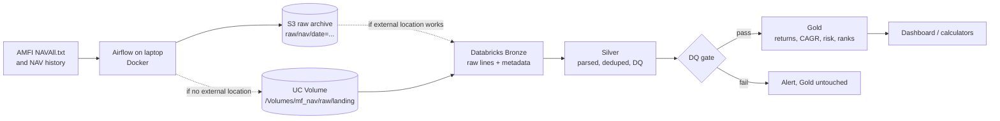

# Mutual Fund NAV Lakehouse

A daily batch pipeline that collects Net Asset Value (NAV) data for every Indian mutual fund scheme from AMFI, stores it in a Delta Lake lakehouse on Databricks using the Medallion architecture (Bronze, Silver, Gold), computes fund analytics (rolling returns, CAGR, volatility, drawdown) and is orchestrated end to end by Apache Airflow.

Status: Phase 0 (setup). See [docs/PROGRESS.md](docs/PROGRESS.md).

## Flow



The S3 path is decided in Phase 0 (see "Raw landing zone" below). The final README will show only the path that is actually used.

## Raw landing zone (S3 decision)

Pending a test in the Databricks Free Edition workspace. Details and both options: [docs/decisions.md](docs/decisions.md) (D1).

## Returns use Growth plans only

IDCW (dividend) NAVs drop on every payout, so they are not total-return series. CAGR, rolling returns and volatility are computed on Growth option plans only. IDCW rows stay in Silver because their latest NAV is still valid.

## Repo layout

```
dags/          Airflow DAGs
src/jobs/      PySpark jobs run on Databricks (bronze, silver, gold)
tests/         pytest unit tests and DAG integrity test
infra/aws/     least-privilege IAM policy for the S3 uploader
infra/airflow/ local Airflow in Docker (built in Phase 6)
docs/          setup findings, decisions, progress, learning guide, glossary
```

## Docs

- [docs/setup.md](docs/setup.md): Phase 0 checks (Databricks Free Edition limits, S3, Airflow plan, source data)
- [docs/decisions.md](docs/decisions.md): design choices with alternatives and trade-offs
- [docs/LEARNING_GUIDE.md](docs/LEARNING_GUIDE.md): study guide, phase by phase
- [docs/glossary.md](docs/glossary.md)

No secrets live in this repo. Copy `.env.example` to `.env` locally; Airflow reads credentials from Connections.
